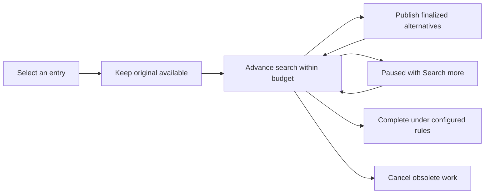

# Responsive matching without silently losing reconciliations

Proposal for [issue #260](https://github.com/jbms/beancount-import/issues/260), researched against upstream `3ee9c40` after reconciling the fork. **Status: for discussion; no new matching algorithm has been implemented.** An independent Astra investigation is incorporated below.

## Recommendation {#recommendation}

Make matching a **bounded, resumable search with an explicit incomplete state**. Keep the current accounting rules and source identities. Return useful alternatives in small batches, let the user continue searching, and materialize expensive candidate views only when needed.

This preserves the useful generality of the matcher while addressing its unbounded interactive work. It requires a search contract, interruptible inner operations, and UI lifecycle changes together. A candidate-count cap alone is a smaller mitigation with weaker guarantees.

There is one unavoidable limit: thirteen entries can genuinely produce thousands of distinct source-consumption choices. Returning every choice cannot take constant time or memory. We can bound a slice of work and preserve access to the remaining search; we cannot promise instant exhaustive results, globally best results, and fixed total resources simultaneously. The proposal makes that tradeoff visible instead of silently deleting possibilities.

## Reconciliation completed {#reconciliation}

The active `feature/nn-classifier` branch now contains upstream through #294, merged as `e4c75c6`. Upstream supplies the reviewed classifier, confidence UI, pending-group bookkeeping, parser, and parse-outcome cache. Refunds, Whole Foods support, narration changes, PayPal sources, and review shortcuts remain local fork features.

The unfinished #60 tentative-account prototype and broad unlisted-card-payment inference are preserved on `backup/nn-before-2026-11-04-reconcile`. They no longer override the reviewed behavior. Whole Foods receipt addition, modification, and removal now invalidate invoice caches; the old `x` shortcut uses the existing Fixme/reset action.

Validation: **314 tests, mypy, TypeScript, and frontend build passed**. Ignored private inputs were not moved or edited. Tracking records and the backup branch stay local.

## What the history establishes {#history}

The matcher was designed for multi-transaction reconciliation, not just finding a duplicate bank row. The [2016 implementation](https://github.com/jbms/beancount-import/commit/3fa3951236927c2eff2b95b42a64dcad3b12c77a) already supports repeated merging, balanced posting correspondences, metadata/cleared-state constraints, partial matches, and aggregates. Its tests include an invoice reconciled against multiple card transactions.

| Development | Property to retain | Lesson for this issue |
| --- | --- | --- |
| [2019 fuzzy weights](https://github.com/jbms/beancount-import/commit/2facf06bcd1fce6b01d224737da09470991df82f) | Matching legitimate small rounding differences | Tightening tolerances is a matching-policy change. |
| [2020 mixed-sign groups](https://github.com/jbms/beancount-import/pull/76) | Item prices, discounts, tax, and large same-sign groups can match payments | A small universal posting/depth limit loses useful cases. Zero-sum exclusions also matter. |
| [2022–23 indexing and caches](https://github.com/jbms/beancount-import/pull/174) | Efficient lookup and reuse | The author still reported spurious matches and long runtimes after major speedups. Faster indexing does not bound search. |
| [#210 fuzzy-bound correction](https://github.com/jbms/beancount-import/pull/210) | Exact lookup eligibility | A seemingly faster implementation can be fast because it returns the wrong answers. Use an output oracle. |
| [#275](https://github.com/jbms/beancount-import/pull/275), [#276](https://github.com/jbms/beancount-import/pull/276) | Stop work already known to be discarded; build indexes on demand | These preserve answers while removing wasted aggregate/index work. Recursive candidate enumeration remains unbounded. |

[Open PR #224](https://github.com/jbms/beancount-import/pull/224) is useful prior art, not a merged fix. It disables partial aggregate subsets for groups of 25 or more and limits recursion. Its guard permits seven added transactions, computes discarded children at the boundary, and does **not** bound the number of partner alternatives or the cost of one pair merge.

The full [history investigation](2026-11-04-matching-history.md) links the original diffs, tests, performance reports, and correctness regressions. The separate [Astra analysis](2026-11-04-astra-matching-analysis.md) includes its reproducible synthetic experiment and independent design assessment.

## What actually explodes {#failure}

Astra reproduced the issue on current upstream with invented transactions. Each has just `Assets:Cash -3 USD` and `Expenses:FIXME 3 USD`, with no metadata or cleared postings:

| Similar entries, including the selected entry | Merged alternatives | Matcher time, one run |
| ---: | ---: | ---: |
| 4 | 7 | 0.006 s |
| 7 | 63 | 0.074 s |
| 10 | 511 | 0.851 s |
| 13 | 4,095 | 10.93 s |

The original adds one more visible option: `2^(N-1)` overall. These are environment-dependent matcher measurements, excluding prediction, staging, serialization, and rendering. They are a synthetic reproduction of the growth pattern, not the reporter's private ticket data.

**No aggregate posting subsets are needed.** Three different layers can be expensive: generating posting aggregates; enumerating ways to merge a pair; recursively adding more transactions. All need consideration. The current webserver runs candidate computation synchronously on the event loop, then prepares every candidate before publishing it. Current pending-entry hover only highlights; selection/skipping triggers computation. [Search and caller](https://github.com/jbms/beancount-import/blob/3ee9c4045d29d47be5b1ea08a8f1b23f041db2b4/beancount_import/matching.py#L1737), [webserver](https://github.com/jbms/beancount-import/blob/3ee9c4045d29d47be5b1ea08a8f1b23f041db2b4/beancount_import/webserver.py#L566).

The repeated-entry results look identical but consume different source entries. Accepting one can remove a different set of pending transactions. Their provenance is part of the operation being approved, so display-text deduplication is unsafe. The current ranking also puts the candidate consuming all thirteen entries first: match counts are not a probability that these purchases were one event. KNN account confidence is a separate quantity and should not be used as match confidence. [Ranking](https://github.com/jbms/beancount-import/blob/3ee9c4045d29d47be5b1ea08a8f1b23f041db2b4/beancount_import/matching.py#L581), [acceptance](https://github.com/jbms/beancount-import/blob/3ee9c4045d29d47be5b1ea08a8f1b23f041db2b4/beancount_import/reconcile.py#L1153).

## The proposed contract {#contract}

A search owns an immutable logical revision of the journal, sources, matching configuration, and selected pending entry. It retains its frontier, visited states, completed results, and unfinished inner calculations.

An `advance` operation takes a work budget, a cooperative deadline, and cancellation signal. It returns completed valid match descriptors, progress counters, and one of:

- **Complete:** the frontier is exhausted under the configured matching rules.
- **Paused:** work remains and a continuation can resume it.
- **Cancelled:** the selection or underlying revision changed.
- **Resource limit:** retained memory or another explicit ceiling stopped the search. This is not completion or an unlimited continuation promise.

Report “23 matches found; more may exist,” not an invented total or “no matches” after an incomplete search. Preserve an exhaustive programmatic wrapper for tests and callers that explicitly request complete search. Continuation must eventually recover the exhaustive result set on finite, small fixtures when resources permit.

Existing matching rules are already heuristic: ordinary aggregate subsets stop at four, larger same-sign groups are special, and the current aggregate threshold can omit a whole subset size. “Complete” therefore means complete under the configured policy, not every mathematically conceivable reconciliation. Record policy/resource omissions separately; continuing an unchanged policy cannot recover combinations that policy excludes.

## Scheduling, identity, and ranking {#scheduling}

Prefer shallow alternatives initially, while giving deeper expansion tasks bounded, recurring turns. Use a deterministic fair queue of resumable tasks rather than spending the first budget on one DFS branch. Pure breadth-first can starve deep matches behind a wide layer; pure best-first can concentrate on the repeated-entry family. Any scheduling preference orders work rather than permanently pruning a branch.

Preserve the current ranking dimensions initially. Partial results are **best found so far**, not certified global top K. An unseen deeper state may outrank an early answer. Define a stable tie-break explicitly; legacy tied discovery order should not be mistaken for evidence of quality. Any intentional tied-order changes need fixture review.

Before changing traversal, audit the state identity. The [current key](https://github.com/jbms/beancount-import/blob/3ee9c4045d29d47be5b1ea08a8f1b23f041db2b4/beancount_import/matching.py#L1619) contains used object IDs and a posting frozenset, omitting posting multiplicity and transaction-level fields. We must establish which fields affect future extensions and score. If its first-discovered representative can affect answers, land a separately reviewed identity correction first; reordering traversal otherwise cannot claim equivalence.

Give distinct source occurrences snapshot-scoped IDs, even when their contents are equal. Candidate IDs must preserve exact source consumption and the transaction being previewed. They cannot be just a rendered-text hash, array index, or persistent Python `id()`.

## Make the expensive inner work resumable {#inner-work}

Check budgets during aggregate attempts, correspondence generation, balancing, cross-currency combinations, and recursive expansion. Count rejected attempts too: counting only accepted results leaves expensive searches with few results uncontrolled.

Two completion barriers are essential:

1. [Dominance filtering](https://github.com/jbms/beancount-import/blob/3ee9c4045d29d47be5b1ea08a8f1b23f041db2b4/beancount_import/matching.py#L1477) currently discards a pair's weaker posting-match sets after enumerating them. An early yielded set may later be dominated. Retain resumable internal work, but publish only finalized pair results.
2. [Opposite-unknown removal](https://github.com/jbms/beancount-import/blob/3ee9c4045d29d47be5b1ea08a8f1b23f041db2b4/beancount_import/matching.py#L1737) depends on proving there was no ordinary match for that posting across the partner scan. An unfinished scan is not evidence of absence. Delay those removal edges until that scan completes.

This means one difficult pair can delay merged alternatives even though the UI remains usable. The original stays available and progress explains which work is unfinished. Do not publish provisional candidates that might later need retraction after the user accepts them.

A cooperative deadline is only as responsive as its largest uninterrupted operation. Profile sorts, large allocations, normalization, prediction, and formatting as well as Python loops. Split oversized operations or report their limitation; do not advertise a hard latency guarantee from an outer counter. Hard process isolation is a possible later backstop, with serialization, restart, and lost-continuation costs.

## UI and ownership {#ui}

Use short cooperative work slices on the existing owning event loop as the first design. This retains safely owned indexes and avoids concurrent reads mutating the new lazy caches. A background thread alone cannot safely cancel work or isolate the live posting database.

**Pausing must be cache-safe.** The current [aggregate expansion](https://github.com/jbms/beancount-import/blob/3ee9c4045d29d47be5b1ea08a8f1b23f041db2b4/beancount_import/matching.py#L341) removes a date from its pending map before adding its aggregates. Inserting cancellation inside that loop could leave a permanently incomplete index. Use index-owned expansion cursors, retaining pending/working/complete state; buffer unfinished contributions and publish atomically. A fuzzy lookup must not treat incomplete inputs as a complete bucket. Cancellation followed by another search, removal, or reload must produce the same index as a fresh build.

Keep the original option visible. Publish finalized alternatives in bounded pages. Build predictions, associated data, staged diffs, and formatted payloads lazily for displayed/selected candidates rather than thousands of unseen alternatives. Budget that preparation too; limiting rendered rows alone leaves server work intact.

Keep one active computation, coalesce rapid navigation, and cancel obsolete work at inner safe points. A generation check prevents stale publication but does not stop CPU use by itself.

Give used-transaction controls stable source IDs and an explicit root/root-group ID; they currently depend on encounter-order indexes. Keep an incremental source catalog even for filtered-out candidates, so sources can be re-enabled without displaying those candidates. Persist exclusion and bulk-Deselect intent over future discoveries. Apply these filters to finalized descriptors before page preparation, **not** to partner discovery: an excluded partner can still supply the ordinary-match witness that suppresses a removal edge. An empty filtered page during incomplete search is not proof that no permitted match exists.

Filtering can hide the selected candidate in the current UI without changing the index that Enter accepts. Fix that invariant explicitly: if the selection becomes hidden, move it to a visible option or disable acceptance. Preserving selection never means accepting an invisible candidate.

Freeze each published ranked result-list snapshot. Page cursors carry its token and filter revision; new discoveries offer a refreshed view instead of silently inserting before an offset and skipping or duplicating rows. Reset paging on refresh while preserving a still-visible selected candidate by ID. A candidate's preview revision stays independent of unrelated result appends, so an unchanged visible diff does not become stale merely because more matches were found.

Validate the data revision, search ID, candidate ID, and candidate preview revision on acceptance. Accepting an entry, changing sources/configuration, or reloading invalidates relevant searches before mutation. Retraining invalidates prediction/view caches independently of raw matching where safe. Preserve current selection and edits as results arrive; never let a changing array index approve a different candidate. Freeze the active edited view or require a refresh rather than overwriting it with new predictions.

Memory has a separate ceiling. Pause with an explicit resource-limit status rather than discard frontier branches and claim exhaustiveness. Unlimited exact continuation at fixed RAM requires spill-to-disk or recomputation; neither is included in the initial proposal.

## Options considered {#options}

| Approach | Benefit | Why it is insufficient as the final design |
| --- | --- | --- |
| Limit the displayed list | Small UI change | Backend matching, prediction, and staging still run exhaustively. |
| Stop after 1,000 DFS candidates | Mitigates this workload | Biased toward the first deep branch; one expansion can still be unbounded. Needs incomplete-result disclosure. |
| Keep only the nearest few partners or impose a depth limit | Much smaller search | Can remove legitimate split payments, grouped invoices, or keyed matches beyond a simple date preference. |
| Best-first or beam search | May find useful answers early | Current score is not an admissible bound; a beam permanently loses alternatives. |
| Deduplicate identical-looking candidates | Cleaner screen | Different provenance can change journal edits and consumed pending entries. |
| Background matching thread | Moves code out of a handler | Does not provide cancellation, bounded work, ownership of mutable indexes, or lower total work. |
| Resumable bounded search | Keeps alternatives accessible and makes work manageable | Requires real inner-operation and UI lifecycle work; retains unbounded total worst-case complexity. |

Stronger source/event metadata, better ranking, and compact presentations of repeated alternatives may improve relevance later. They need separate semantics and regression cases. Inferring that transactions from one source can never merge would also lose legitimate multi-charge reconciliations.

## A reviewable delivery sequence {#delivery}

1. **Baseline and invariants.** Commit the synthetic repeated-entry regression, phase counters, and exhaustive small-case oracle. Audit identity before changing discovery order. Keep the historical financial matching tests.
2. **Resumable engine behind a compatibility wrapper.** Split this into verified refactors for cancellation-safe indexes, aggregate work, pair work, and outer traversal. Introduce the search/result contract and retained frames, including dominance/removal completion barriers. Preserve exhaustive behavior for existing callers. Measure work, memory, and the largest atomic operations.
3. **Interactive integration.** Add fair scheduling, pause/continue/cancel states, stable candidate/view IDs, lazy page preparation, and snapshot invalidation. Enable the UI path only when these pieces work together. Calibrate budgets from measurements rather than choosing 1,000 because it sounds small.
4. **Relevance improvements separately.** Evaluate a ranking change or explicit ambiguity grouping with evidence. A group must retain a concrete provenance choice before acceptance; it cannot silently replace several different actions with one.

A small outer cap with honest disclosure is an acceptable emergency mitigation, but it should be described and tested as such. I recommend the sequence above for the durable fix, not merging #224 unchanged or promising that one added limit solves all layers.

## Shipping evidence {#validation}

- Completed continuations match exhaustive small-case results, including full transaction contents, repeated posting multiplicities, score values, and exact consumed source occurrences. Document any intentionally changed tied ordering.
- Keep mixed-sign/zero-subset/maximal-group tests, multi-transaction invoices, keyed checks, fuzzy boundaries, cleared protections, investments/costs, currencies, and incomplete postings.
- Assert deterministic work limits on the 13-entry family; test that the original remains available and shallow alternatives get a fair turn. Use timing as a benchmark rather than a brittle unit assertion.
- Put a valid match beyond the first partner shortlist and beyond a tempting depth cutoff. Repeated continuation must still find it when resources permit.
- Exercise a slow single pair, a late dominating match set, and a late ordinary match that suppresses a removal. No published candidate may be rejected by the exhaustive rules later.
- Cancel during lazy index building and pair search; then restart, reload, remove a source, accept another transaction, or retrain. Compare the index to a fresh build. Test stale acceptance, preserved edits, memory limits, expired sessions, and complete versus incomplete empty results.
- Hide the selected candidate with a source filter and press Enter: it must not be accepted. Append new sources after bulk Deselect, re-enable a filtered-out source through the catalog, reject old-filter pages, and insert a better-ranked result at a page boundary without skipping or duplicating an item.
- Verify cold/warm caches and different batching schedules yield the defined same results, and preparation work scales with the displayed page rather than the discovered population.

Astra independently reached the same core recommendation: explicit incomplete results, fair bounded work, continuation, cancellation, and lazy presentation. Its cautions about provenance, inner completion barriers, ranking, cache cancellation, source filters, selection, pagination, and memory limits are incorporated here. The remaining engineering cost is explicit; there is no claim of eliminating the exponential worst case.
